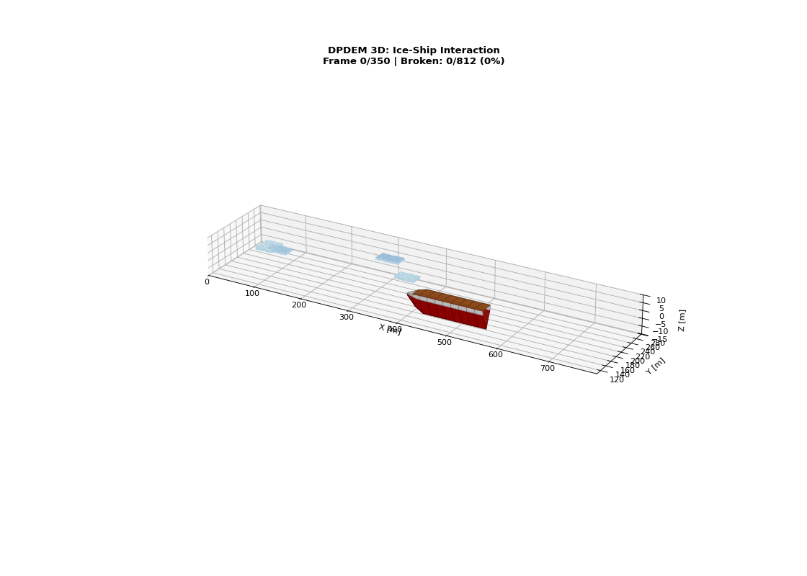
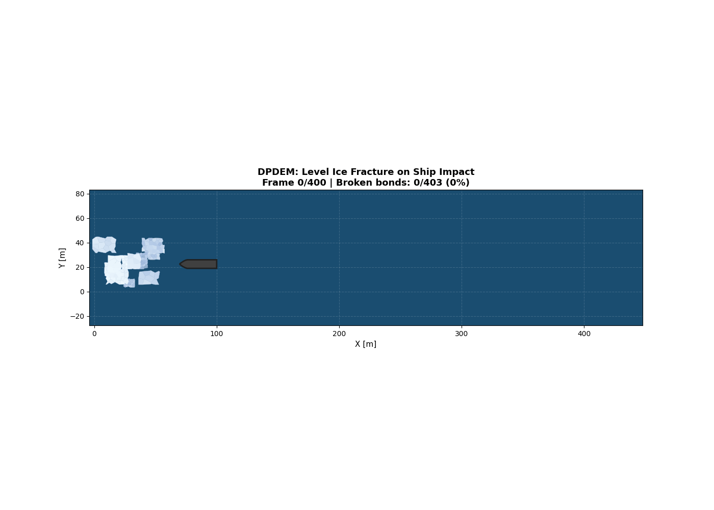

# DPDEM: Dilated-Polyhedron-based Discrete Element Method

Implementation of ice-ship interaction simulation based on:

> Wang et al. (2024) - "Interaction between ice cover and floating platform simulated by dilated-polyhedron-based DEM" - Ocean Engineering 301

## 3D Visualization



**CCGS John G. Diefenbaker** polar icebreaker interacting with Arctic sea ice:
- Ship: 158m length, 28m beam, 10.5m draft
- Ice: Voronoi tessellation, 2.5m thickness
- Physics: Bond fracture, stress propagation, ice sliding under hull

## Features

- **Voronoi ice elements**: Irregular polygon shapes as per paper Fig. 2
- **Bond mechanics**: Adjacent elements bonded, fracture under stress (Eq. 14)
- **Stress propagation**: Cracks propagate through ice sheet
- **3D physics**: Ice tilts, breaks, and slides under hull (Fig. 17)
- **Realistic ship**: Proper hull shape with tapered bow

## 2D Top-Down View



## Usage

```bash
# Install dependencies
pip install -r requirements.txt

# Run 2D simulation
python visualize_ice_ship.py

# Run 3D simulation  
python visualize_ice_ship_3d.py
```

## References

- Wang, X., Liu, L., Wang, S., & Ji, S. (2024). Interaction between ice cover and floating platform simulated by dilated-polyhedron-based DEM. Ocean Engineering, 301, 117413.
